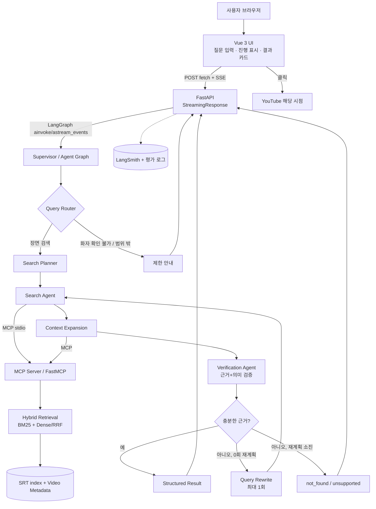
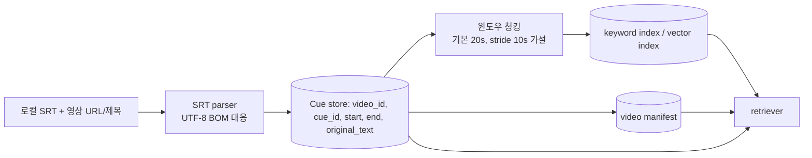

# WISH FINDER — 시스템 아키텍처

- 상태: Proposed v0.1 / 사용자 승인·리포지토리 실사 전
- 최우선 원칙: **Day 2까지 브라우저에서 실제 작동**, Day 3 13:00 이전 제출.
- 참고: `requirements.md` / `adr/`.

## 1. 시스템 경계 및 컴포넌트



주의: `F`의 불확실성 처리는 관련 장면 자체의 검색을 포기한다는 뜻이 아님. **화자 미확인 질문에서도 장면 근거는 찾아 줄 수 있고**, 확인할 수 없는 것은 화자 정보만이다.

## 2. 권장 기술 스택과 선택 사유

| 계층 | 제안 | 근거/제약 |
|---|---|---|
| Frontend | Vue 3 + Vite, 단일 페이지 | 결과 카드·상태 UI 구현 편의. 복잡한 컴포넌트 라이브러리는 제외 |
| Backend | Python 3.11+, FastAPI, Pydantic | API 계약, 비동기 SSE, LangGraph와 일관된 런타임 |
| Graph | LangGraph | 조건 라우팅, 재검색 상한, 상태 추적 |
| Agent 역할 | Search Agent, Verification Agent, Supervisor | 각 역할과 출력 계약 구분. 단순 노드와 독립 sub-agent를 혼동하지 않기 |
| MCP | FastMCP, 로컬 stdio | 재사용 가능한 검색·문맥 조회 도구. 프로세스/SDK 차이는 실제 환경에서 확인 |
| Keywords | BM25 (`rank_bm25` 또는 동급) | 이름·고유명사, 영문 검색어 처리 |
| Dense/Store | 다국어 embedding + Chroma(또는 동급 로컬 DB) | 한국어 입력 ↔ 영어 인덱스; 모델 다운로드/품질 실측 필요 |
| Fusion | Reciprocal Rank Fusion(RRF) | 서로 다른 스코어 단위를 보정하는 간단한 순위 통합 |
| Source of truth | 로컬 SRT + video manifest(JSON/SQLite) | 인용/시간을 반드시 원본 cue에서 역조회 |
| Tracking | LangSmith + 로컬 JSON 로그 | 단계별 지연, 호출, 에러. LangSmith 비활성 환경에서도 실행 유지 |
| Testing | pytest + 고정 질문/정답 JSONL | 정확성/실패/성능 회귀 검증 |

### 2.1 LLM 선택의 결정은 유보

로컬 Ollama 또는 사용자가 허용한 API 중 실제 실행 가능한 것을 Codex가 환경조사 후 제안한다. **유료 호출을 사용자 동의 없이 실행하지 않는다.** 분류/검색어 재구성은 작은 모델, 의미 검증/최종 요약은 품질이 나은 모델을 사용할 수 있으나 이것은 P1 최적화다.

## 3. 오프라인 데이터 파이프라인



### 3.1 데이터 객체

`Video`: `video_id`, `title`, `url`, `transcript_file`, `language="en"`, `license_or_source_note`, `indexed_at`.

`Cue`: `cue_id`, `video_id`, `start_seconds`, `end_seconds`, `original_text`, `speaker=null`, `mentioned_members[]`, `caption_type`(`dialogue|editorial|mixed|unknown`).

`Chunk`: `chunk_id`, `video_id`, `start_seconds`, `end_seconds`, `cue_ids[]`, `text_for_retrieval`.

`Evidence`: `video_id`, `cue_ids[]`, `start_seconds`, `end_seconds`, `exact_source_text`, `evidence_type`, `speaker_status`.

- `mentioned_members`는 키워드 또는 괄호 설명에 포함된 이름일 뿐 **발화자 식별 근거가 아니다**.
- 편집 자막 `(RIKU chose RIKU)`처럼 대사가 아닌 **화면 설명도 검색 데이터로 유지**한다.
- 한 구간에 `- A / - B`처럼 여러 명의 대사가 섞일 수 있으므로 텍스트만으로 자동 화자 태깅 금지.
- 벡터 검색에서는 청크를 반환해도 **최종 인용은 cue 레벨에서 다시 조회**한다.
- 검색 청킹 기본 가설은 20초 창/10초 중첩. 평가 결과에 따라 조정하되 윈도우가 영상 경계를 넘지 않도록 한다.
- `speaker=null` 대신 허위 확률·가짜 발화자 모델 출력 사용 금지.

## 4. LangGraph 상태와 경로

### 4.1 최소 State 계약

```python
class FinderState(TypedDict, total=False):
    request_id: str
    user_query: str
    intent: Literal["scene_search", "speaker_query", "unsupported", "chat"]
    query_terms: list[str]
    query_en: str | None
    attempt: int                 # 초기 = 0, 재계획 후 = 1
    candidate_chunks: list[dict]
    evidence_items: list[dict]
    validation: dict             # is_grounded, relevant, reason, can_answer_speaker
    result_status: str           # found/ambiguous/not_found/unsupported/partial/error
    final_results: list[dict]
    error_info: dict | None
```

*상태 정의는 인터페이스 제안이며 현재 구현 코드는 아니다.*

### 4.2 역할 분리

1. **Router/Supervisor**: 장면 검색, 화자 확인 질문, 일반 발화/불가능한 범위 여부 분류. `speaker_query`라도 검색 가능한 장면은 탐색.
2. **Search Agent**: 자연어 기억을 영어 동의어/키워드로 정규화, MCP 검색 Tool 선택·호출, 필요한 문맥 조회. Search Agent에는 답변 사실 생성 책임을 주지 않는다.
3. **Verification Agent**: 원본 cue 재확인, 문맥 일치 검토, 질문의 주장과 자막 근거를 구분. 화자 추정과 부정확한 인용 차단. 코드 검증과 의미 검증을 결합.
4. **Supervisor Finalize**: 검증 완료된 Evidence만 사용자 응답에 포함, 재검색 가능/종료 판단.

**진짜 Multi-Agent 기준**: Search와 Verification이 각각 독립된 목표·입출력 계약·도구 권한·프롬프트를 가진 Agent/Subgraph로 구현되어 서로 다른 역할을 수행해야 한다. 함수 두 개를 단순히 `Agent`라고 명명하는 것만으로 Multi-Agent라고 주장하지 않는다. 시간/성능을 재서 P0 유지가 불가능하면 사용자에게 명시적으로 제안하고 승인을 받는다.

### 4.3 상한 및 검증 순서

- 검색 초기 시도: `attempt = 0`, 최대 재검색 1회(`attempt = 1`).
- 처음부터 무조건 재검색하지 않는다. 검색 후보·근거의 부족/오탐 가능성이 있을 때만.
- 원문 인용/시간/비디오 ID를 결정적 로직으로 검증하고, 의미 관련성을 Agent가 추가 평가.
- Validator가 실패하면 이미 생성한 미검증 초안은 **화면에 내보내지 않음**.
- 재검색 실패 후 결과가 없다면 `not_found`; 범위 밖이면 `unsupported`; 일부 유효 후보만 있으면 `partial` 또는 `ambiguous`.
- 무한 루프 방지: `MAX_REPLAN_ROUNDS=1`, LLM 호출 timeout, 전체 요청 timeout.

## 5. MCP 인터페이스

**MCP 서버는 Agent에게 필요한 도구를 제공하는 경계**이며 UI가 MCP에 직접 접근하지 않는다. 초기 배포는 로컬 stdio가 적합하지만 해당 환경에서 subprocess lifecyle/handshake를 검증한다.

| 이름 | 인자 | 응답 | 주요 제약 |
|---|---|---|---|
| `search_transcripts` | `query: str`, `mode: hybrid|keyword|dense`, `top_k: int`, `video_ids: list[str]?` | 정렬된 후보 청크·스코어·cue_ids | 읽기 전용, 제한된 top_k, 원본 cue ID 포함 |
| `get_scene_context` | `video_id: str`, `start_seconds: float`, `window_seconds: int` | 시간순 자막 목록, 인접 원문 | window 상한, 영상 존재 검증 |
| `get_video_metadata` | `video_id: str` | 제목·원본 URL·자막 상태 | 미등록 영상이면 명확한 오류 |

도구 docstring에 목적·입력·출력·제약·예외를 명확하게 기술한다. 정적 카탈로그 Resource(`wishfinder://videos/catalog`)와 표준 검색 Prompt는 P1이다. 사용자가 자막 파일의 로컬 경로를 Tool 인자로 임의 지정하지 못하도록 한다.

## 6. API 및 SSE 구조

### 6.1 FastAPI

- 서버 **lifespan**에서 Agent, 인덱스, MCP 세션을 초기화하여 요청마다 재생성하는 비용을 피함. 종료 시 MCP/DB 자원 정리.
- `POST /api/search/stream`은 JSON 입력을 받아 SSE로 상태와 결과를 제공.
- `GET /api/videos`는 인덱싱된 영상의 제목/URL/자료 유무를 반환.
- `GET /health`는 liveness; index/LLM/readiness 상태는 에러 화면과 분리.

### 6.2 SSE 이벤트 데이터

```text
event: routing
data: {"request_id":"req-123","message":"질문 유형을 확인하고 있어요."}

event: searching
data: {"request_id":"req-123","attempt":0,"message":"관련 장면을 검색 중이에요."}

event: validating
data: {"request_id":"req-123","message":"원문과 시간을 확인 중이에요."}

event: replanning
data: {"request_id":"req-123","attempt":1,"message":"다른 표현으로 다시 찾고 있어요."}

event: result
data: {"request_id":"req-123","status":"found","results":[{"video_id":"1HJgbE66GI4","start_seconds":189,"end_seconds":191,"evidence_text":"(RIKU chose RIKU)","speaker":null,"url":"https://www.youtube.com/watch?v=1HJgbE66GI4&t=189s"}]}

event: done
data: {"request_id":"req-123","status":"found"}

```

- POST SSE이므로 `EventSource` 단독 사용하지 않고 Vue 프론트의 `fetch` + `ReadableStream` 파서를 사용.
- 이벤트를 임의 JSON 청크 단위로 파싱하면 분할 수신에서 오류가 생김. **`\n\n` 프레임 경계 및 멀티라인 data 지원**이 중요.
- 상태 이벤트는 작업 결과 요약만; chain-of-thought나 미검증 자연어 초안을 보내지 않는다.
- 실제 error는 `event:error` + `done`으로 매핑하며, 연결이 끊긴 경우에는 클라이언트가 안전하게 종료 상태를 표시.
- 링크 생성 시 허용 도메인/정확한 video ID/초 단위 시간 검증. 공개 동영상 URL을 조합하되 존재하지 않는 video ID를 생성하지 않음.

## 7. 장애 상황과 우아한 복구

| 실패 | 처리 |
|---|---|
| 자막 0개 / 비정상 포맷 | 데이터셋 인덱싱 시 명확한 실패; 검색 API는 준비되지 않았다고 알림 |
| Dense 모델 초기화 실패 | 장애 표시 + 가용한 keyword-only 결과를 `partial`로 반환 가능. Dense가 실행된 것처럼 표시 금지 |
| MCP subprocess 중단 | 제한된 재연결/도구 실패 구분; 검증되지 않은 결과 생성 금지 |
| LLM timeout | 정해진 timeout 내 제한된 재시도 또는 `partial/error`로 종료 |
| 검색 결과 없음 | query rewrite 1회 → 없으면 `not_found` |
| 화자 식별 질문 | 장면은 검색하되 화자는 `unknown`으로 명시 |
| SSE 네트워크 단절 | 프런트 오류 + 재검색 버튼. 요청 결과가 전송됐다고 성공 처리하지 않음 |
| LangSmith 접속 실패 | 추적만 비활성화/로컬 로그로 복구, 핵심 검색 기능 유지 |

## 8. 성능과 평가

- Dataset: `video_id + 타임스탬프 허용 구간 + 대표 원문 cue + answerability`의 고정 레이블.
- 실험 A: BM25, B: Hybrid, C: Hybrid+Agent. 동일 영상, 동일 질문, 동일 정답/허용 시간 기준.
- **제어 실험**: 초기 검색어와 embedding 설정을 맞춘 B/C 비교를 수행해야 Replanning/Validator 기여를 이야기할 수 있다.
- Latency: 첫 상태 이벤트, 전체 완료 시간; 실패·재검색 케이스 분리.
- Accuracy: Hit@3, Scene Success@1, unsupported 정확률, 허위 화자 단정 건수.
- End-to-end: 최소 1개 브라우저 자동/수동 시나리오 + SSE 스트림 단위 테스트.
- LangSmith: 그래프 실행 단위 run ID, 노드별 duration, tool count, 실패 위치 관측. 외부 도구 미연결 시 로컬 trace JSON 대체.

## 9. 파일 트리 초안

아래는 **새 리포지토리를 사용할 때의 권장 구조**다. 기존 리포지토리가 있다면 Codex가 실사 후 변경안을 제안하며 무조건 덮어쓰지 않는다.

```text
wish-finder/
├─ README.md
├─ .env.example
├─ .gitignore
├─ docs/
│  ├─ requirements.md
│  ├─ architecture.md
│  ├─ adr/
│  │  ├─ README.md
│  │  └─ 0001-....md ...
│  └─ reports/
├─ backend/
│  ├─ app/main.py
│  ├─ app/schemas.py
│  ├─ app/agent/{graph.py,state.py,search_agent.py,verification_agent.py}
│  ├─ app/mcp/server.py
│  ├─ app/retrieval/{srt_parser.py,chunker.py,bm25.py,dense.py,hybrid.py}
│  ├─ app/services/{video_catalog.py,evidence.py}
│  └─ tests/
├─ frontend/
│  ├─ package.json
│  └─ src/{App.vue,api/sse.ts,components/...}
├─ data/
│  ├─ manifest.example.json
│  ├─ raw/              # 전체 외부 자막, .gitignore
│  └─ fixtures/         # 합성 테스트 파일/가공한 최소 예제
└─ eval/
   ├─ dataset.example.jsonl
   ├─ run_eval.py
   └─ results/             # 실측 결과/환경 설정
```

## 10. ADR 연결

- ADR-0001: 자막 정보와 화자 미식별 처리
- ADR-0002: Hybrid Search와 다국어 질의 처리
- ADR-0003: LangGraph 역할 분리 및 bounded replanning
- ADR-0004: 로컬 FastMCP subprocess 경계
- ADR-0005: Vue + FastAPI POST SSE
- ADR-0006: 원문 cue 보존/윈도우 청킹/근거 회귀 검증

## 11. 구현 전 확인사항

1. 로컬 환경: python/node/LLM/embedding 설치·다운로드 가능성.
2. 사용자 허용 API와 금전 비용 범위.
3. 추가 SRT 2개 준비 여부와 영상 메타데이터.
4. 기존 Git 리포지토리 유무, `AGENTS.md` 및 프로젝트 규칙.
5. 오프라인 실행 요구, 데모 환경과 네트워크 안정성.
6. Day 3 13:00 제출을 고려한 Phase 1 범위 잠금.

위 사항은 Codex Plan Mode에서 **검토와 제안**까지만 수행한다. 사용자 승인 전 실제 구현·리팩터링·커밋 금지.
